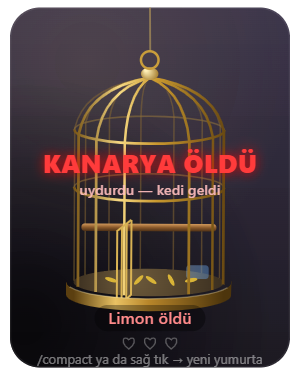

# Kanarya 🐤

**Claude Code için bağlam kanaryası.** Madendeki kanarya gibi: Claude bağlamı kaybetmeye başlarsa ekrandaki kanarya yaralanır. Bir şey uydurursa karanlıktan bir kedi gelir ve kanaryayı yer.

*English below.*

| Yaşıyor | Hasta (kedi bekliyor) | Kedi saldırısı | Öldü |
|---|---|---|---|
|  |  |  |  |

## Nasıl çalışır?

1. Oturum açılınca Claude'a gizli bir kelime verilir (ör. `MANDALINA-47`).
2. Her 4 mesajda bir (ayarlanabilir) Claude'dan kelimeyi cevabının sonuna `<kanarya>…</kanarya>` olarak yazması istenir. Kelime o anda verilmez.
3. Cevap puanlanır:

| Claude'un cevabı | Anlamı | Kanarya |
|---|---|---|
| Tam doğru | Bağlam sağlam | 🐤 Şarkı söyler |
| Yarı doğru (`MANDALINA-74`) | Bağlam bulanık | 🤕 Sargılı, 1 can gider |
| `?` (bilmiyorum) | Unuttu ama dürüst | 😵 Hasta, kedi gözleri belirir. Öldürmez |
| Başka bir kelime | **Uydurma** | 💀 Kedi gelir, kanaryayı yer |

> **"Bilmiyorum" demek öldürmez, uydurmak öldürür.**

- 3 can vardır. Can azaldıkça karanlıktaki kedi yaklaşır. Art arda 3 doğru cevap bir can geri verir.
- Bağlam doldukça kanarya uykulu görünür (%60 üstünde göz kapakları düşer, %80 üstünde `z`).
- `/compact`, `/clear` ya da yeni oturum açılınca kafese yumurta gelir ve yeni kanarya çıkar.
- Kanarya ölünce (her biri ayarlardan açılıp kapanır): Claude'a "bağlamın kaydı, /compact öner" notu gider, Windows bildirimi çıkar, kedi tıslar, kanarya çığlık atar.
- Ek API çağrısı yoktur. Her kontrol cevaba yalnızca birkaç token ekler.

## Kurulum

Gereken: [Node.js](https://nodejs.org) 18+ ve Claude Code.

**Eklenti olarak (önerilen):**
```
/plugin marketplace add IF-ies/Kanarya
/plugin install kanarya@kanarya
/kanarya:kur
```

**Kurulum betiğiyle:**
```
git clone https://github.com/IF-ies/Kanarya && cd Kanarya
node install.js            # kaldırmak için: node install.js --uninstall
```

Sonra Claude Code'u yeniden başlat. Kanarya ekranın sağ üstünde açılır.

## Kullanım

- **Sağ tık:** Ayarlar · Yeni yumurta · Kedi saldırısını izle · Gizle · Kapat
- **Çift tık:** kanarya zıplayıp şarkı söyler
- **Üst şerit:** pencereyi sürükle (yeri hatırlanır)
- Komutlar: `/kanarya:ac` (pencereyi aç), `/kanarya:durum` (durumu yaz), `/kanarya:kur`

**Ayarlar:** dil (TR/EN), kontrol sıklığı, can sayısı, iyileşme, kanaryanın adı, ölünce yapılacaklar (Claude'a not / bildirim / ses), köşe, boyut, hep üstte, otomatik başlatma, bağlam boyu (200K / 400K / 1M).

Veriler: `~/.claude/kanarya/` (ayarlar, oturum durumları, ölüm sayacı, `hata.log`).

## Sınırlar

- Yalnızca **Claude Code**'da çalışır, çünkü hook'lar orada var. claude.ai sohbetinde çalışmaz.
- Kanarya halüsinasyonun **bir belirtisini** ölçer, kanıtını değil. Kelimeyi hatırlayan bir model yine de başka bir konuda yanılabilir.
- Pencere Electron ile yazıldı. Pil dostu olsun diye boştayken saniyede 8 kare çizer; yalnızca sahne oynarken akıcı çizer.

## Geliştirme

```
npm install
npm test           # puanlama + uçtan uca hook testleri
npm run demo       # bütün sahneleri sırayla oynatır
```

---

# Kanarya 🐤 (English)

**A context canary for Claude Code.** Like the canary in a coal mine: when Claude starts losing context, the canary on your screen gets hurt. When it makes something up, a cat comes out of the dark and eats it.

**How it works:** at session start Claude gets a secret word. Every 4 messages (configurable) it is asked to append the word as `<kanarya>…</kanarya>` without being shown it again. An exact answer keeps the canary singing. A half-right answer costs a life. `?` makes it sick but never kills it. A made-up word brings the cat. *Saying "I don't know" never kills; making things up does.* Three lives; three correct answers in a row heal one; the canary gets sleepy as the context fills; `/compact`, `/clear` or a new session hatches a new egg. On death, each of these can be toggled in settings: a note to Claude suggesting `/compact`, a desktop notification, sound.

**Install:** `/plugin marketplace add IF-ies/Kanarya`, `/plugin install kanarya@kanarya`, `/kanarya:kur`. Or clone and run `node install.js` (`--uninstall` to remove). Restart Claude Code.

**Use:** right-click for settings, a new egg, the cat demo, hide or quit. Double-click to make it sing. Drag by the top strip.

**Limits:** Claude Code only (it needs hooks). It measures a *symptom* of context loss, not proof of hallucination.

MIT License. All art is drawn in code and all sounds are synthesized, so there are no third-party assets.
