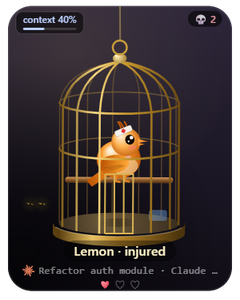
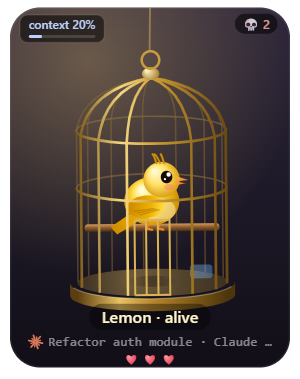
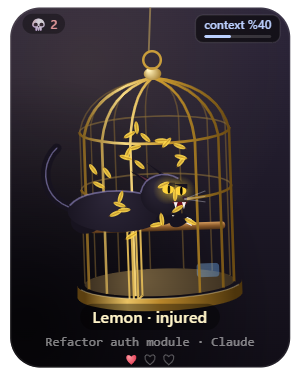
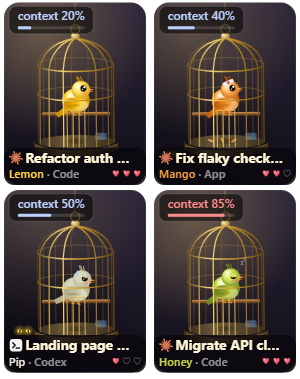
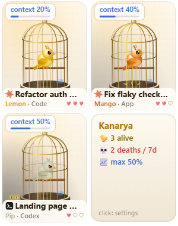
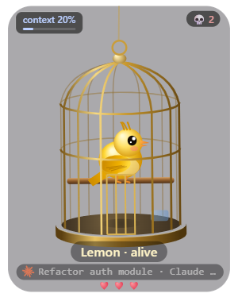
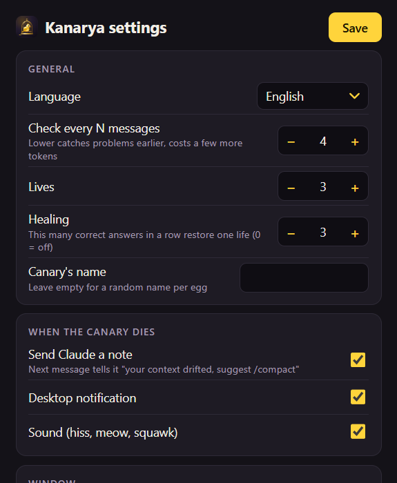

<p align="center"></p>

# Kanarya 🐤 — Context Canary for Claude Code & Codex

**A Claude canary that tells you when Claude Code (or OpenAI Codex) loses context or starts hallucinating.**
A cute 2.5D canary sits in a cage on your desktop. When Claude's context gets blurry, the canary gets hurt. When Claude *makes something up*, a cat comes out of the dark and eats it.

[🌐 Website](https://if-ies.github.io/Kanarya/) · [Türkçe ↓](#türkçe)

<p align="center"></p>

| Alive | Sick (the cat is watching) | Cat attack | Dead |
|---|---|---|---|
|  |  |  |  |

**Every open session gets its own canary** in one small always-on-top window, labelled with the session title and its agent (Claude Code, Claude App or Codex). Light, dark and transparent looks:

| Many sessions | Light theme | Transparent | Settings |
|---|---|---|---|
|  |  |  |  |

## What is it? (plugin, not a skill or MCP)

Kanarya is a **Claude Code plugin** made of **hooks** (`SessionStart`, `UserPromptSubmit`, `Stop`, `SessionEnd`) plus a few slash commands, and a small **desktop app** (Electron) that draws the canary. It is not a *skill*, because skills are instructions Claude chooses to load, while a canary must run on every message whether Claude wants it or not. It is not an *MCP server* either, because MCP gives Claude tools to call, while Kanarya checks Claude from the outside. The same hooks also run in **OpenAI Codex**.

## Platforms

| | Status |
|---|---|
| Windows 10/11 | ✅ Tested (development machine) |
| macOS | ⚠️ **Not tested yet.** Everything used is cross-platform (Node, Electron, tray in the menu bar), but it has not been run on a Mac. Reports and PRs welcome. |
| Linux | ⚠️ **Not tested yet.** Transparent windows depend on the desktop compositor. |
| OpenAI Codex | ⚠️ **Not tested in a real Codex session yet.** The hooks follow the Codex hooks docs and pass automated tests with Codex-shaped inputs (`last_assistant_message`, rollout transcript, `SessionEnd`). |

## Why?

Long Claude Code sessions slowly degrade (often called *context rot*): instructions get forgotten, details get mixed up, and the model starts to confidently guess. Kanarya is a **canary in the coal mine** for that. It is a tiny, cheap, always-on context health check with a face you will not want to let die. So you `/compact` or start a fresh session *before* bad output lands in your code.

## How it works

1. At session start a `SessionStart` hook gives Claude a secret word (e.g. `TANGERINE-47`).
2. Every 4 messages (configurable) a `UserPromptSubmit` hook asks Claude to append the word as `<kanarya>…</kanarya>`. The word is **not** shown again.
3. A `Stop` hook reads the reply from the transcript and grades it:

| Claude's answer | Meaning | Canary |
|---|---|---|
| Exact word | Context is healthy | 🐤 Sings |
| Half right (`TANGERINE-74`) | Context is blurry | 🤕 Bandaged, −1 life |
| `?` (I don't know) | Forgot, but honest | 😵 Sick, cat eyes appear. **Never kills** |
| A different word | **Hallucination** | 💀 The cat eats the canary |

> **Saying "I don't know" never kills the canary. Making things up does.**

- 3 lives. The cat creeps closer as lives drop. 3 correct answers in a row heal one life.
- The canary gets sleepy as the context window fills (reads token usage from the transcript).
- `/compact`, `/clear` or a new session hatches a new egg with a new word.
- When the canary dies, each of these can be toggled in settings: a note to Claude ("your context drifted, suggest /compact"), a desktop notification, sound.
- No extra API calls. Each check adds only a few tokens to a reply.

## Install

Requires [Node.js](https://nodejs.org) 18+ and [Claude Code](https://claude.com/claude-code).

**As a Claude Code plugin (recommended):**
```
/plugin marketplace add IF-ies/Kanarya
/plugin install kanarya@kanarya
/kanarya:kur
```

**With the install script (Claude Code + Codex):**
```
git clone https://github.com/IF-ies/Kanarya && cd Kanarya
node install.js            # remove with: node install.js --uninstall
```

The script adds the hooks to `~/.claude/settings.json` and `~/.codex/hooks.json` (`--no-claude` / `--no-codex` to skip one). Restart Claude Code. In Codex, run `/hooks` once and trust the Kanarya hooks. The canary appears in the top-right corner of your screen.

**Many sessions at once:** each open Claude Code or Codex session gets its own canary in the same window, in its own color (yellow, orange, white, green, cinnamon). It is labelled with the session title (Claude Code's own title or your `/rename`), and Codex sessions are marked as such. When a session ends, its canary leaves; a new session hatches from an egg.

## Use

- **Tray icon** (Windows notification area / macOS menu bar): click to show or hide, right-click for settings and quit
- **Right-click:** Settings · New egg · Watch the cat attack · Hide · Quit
- **Double-click:** the canary hops and sings
- **Top strip:** drag the window (position is remembered)
- **Click through** (Settings or tray menu): clicks pass to whatever is behind, as if the canary was not there
- **Bottom corners:** drag to resize (the cage keeps its shape; size is remembered)
- Commands: `/kanarya:ac` (open window), `/kanarya:durum` (status), `/kanarya:kur` (install window)

**Settings:** language (English / Turkish), theme (dark / light / system), transparent background, check frequency, lives, healing, canary name, what happens on death, corner, size, always on top, auto start, context size (200K / 400K / 1M).

Data lives in `~/.claude/kanarya/`.

## Limits

- Works in **Claude Code** and **OpenAI Codex**, because both have hooks. It does not work in plain chat apps (claude.ai, ChatGPT).
- It measures a *symptom* of context loss, not proof of hallucination.
- The window is Electron. To save battery it draws 8 fps when idle and only animates smoothly while a scene plays.

## Development

```
npm install
npm test           # grading + end-to-end hook tests
npm run demo       # plays every scene
```

Related keywords: Claude canary, Claude Code canary, Codex canary, context canary, hallucination detector, context rot, context window monitor, Claude Code plugin, Claude Code hooks, Codex hooks.

---

## Türkçe

**Claude Code için bağlam kanaryası.** Madendeki kanarya gibi: Claude bağlamı kaybetmeye başlarsa masaüstündeki kanarya yaralanır. Bir şey uydurursa karanlıktan bir kedi gelir ve kanaryayı yer.

- Oturum açılınca Claude'a gizli bir kelime verilir. 4 mesajda bir (ayarlanabilir) kelimeyi cevabın sonuna `<kanarya>…</kanarya>` olarak yazması istenir.
- Tam doğru 🐤 şarkı. Yarı doğru 🤕 −1 can. `?` 😵 hasta ama ölmez. Uydurma 💀 kedi yer. **"Bilmiyorum" demek öldürmez, uydurmak öldürür.**
- 3 can vardır. Art arda 3 doğru cevap bir can geri verir. Bağlam doldukça kanarya uykulu görünür. `/compact` ya da yeni oturum açılınca yumurtadan yeni kanarya çıkar.
- Kanarya ölünce Claude'a not, Windows bildirimi ve ses (hepsi ayarlardan ayrı ayrı açılıp kapanır).
- Claude Code ve Codex'te çalışır. Açık her oturumun kendi kanaryası olur; hepsi tek pencerede, 2x2 ızgarada durur. Her kanaryanın altında oturumun başlığı yazar.
- **Kurulum:** `/plugin marketplace add IF-ies/Kanarya` → `/plugin install kanarya@kanarya` → `/kanarya:kur`, ya da `node install.js` (Claude Code + Codex; Codex'te bir kez `/hooks` ile onayla).
- Sağ tık: ayarlar, yeni yumurta, kedi saldırısını izle. Arayüz Türkçe ve İngilizce; koyu, açık ve şeffaf görünüm.
- **Ne bu?** Bir Claude Code **eklentisi** (hook'lar + birkaç komut) ve kanaryayı çizen küçük bir masaüstü uygulaması. Skill değil, çünkü her mesajda Claude istese de istemese de çalışması gerekiyor. MCP de değil, çünkü Claude'a araç vermiyor, onu dışarıdan denetliyor.
- **Platform:** Windows'ta test edildi. **macOS ve Linux henüz test edilmedi.**

MIT License. All art is drawn in code and all sounds are synthesized, so there are no third-party assets.
